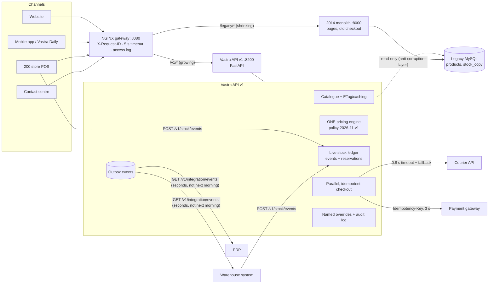

# Vastra API v1 — modernising the legacy estate with FastAPI (strangler pattern)

This service is the **"new door"** for Vastra & Co. It sits beside the 2014 monolith from
`vastra-legacy-lab`, behind the NGINX gateway that is already in the repo (`gateway/nginx.conf`:
`/legacy/*` → monolith on :8000, `/v1/*` → new services on **:8200**).

We don't rewrite the monolith. We put versioned REST APIs in front of the capabilities that hurt most, move
callers across one at a time, and leave the monolith running until nothing calls it.

---

## 1. Target architecture



**Key ideas**

| Pattern | Where | Why |
|---|---|---|
| Strangler fig behind a gateway | `gateway/nginx.conf` (existing) + this service | Move one route at a time; roll back by changing one NGINX line |
| Anti-corruption layer | `vastra_api/legacy_catalogue.py` | Read the legacy tables **read-only**, translate to clean models, fix the UTC bug at the boundary |
| Single source of truth for price | `vastra_api/pricing.py` | Web, app and POS all call `/v1/prices` — one answer, one breakdown, one version |
| Event-sourced stock ledger | `vastra_api/stock.py` | POS/WMS push movements as they happen; checkout reserves atomically |
| Idempotency keys | `routers/checkout.py`, `partners.py` | A retried checkout returns the same order and never charges twice |
| Timeouts + graceful fallback | `partners.py` | A slow courier gives an *estimated* promise instead of hanging the site |
| Transactional outbox | `audit.emit()`, `/v1/integration/events` | Order + stock change + integration event commit together; ERP gets it in seconds |
| Per-client / per-person API keys + audit | `security.py`, `/v1/admin/*` | Replaces the shared DB login and the shared `MGR-OVERRIDE` code |

---

## 2. Legacy defect → API fix

| Legacy defect (evidence) | Legacy code | New API | Proved by test |
|---|---|---|---|
| **R1** Pages built on every request, no cache (E4: LCP 4.8 s) | `monolith.product_page` | `GET /v1/products/{sku}` with `ETag`, `Cache-Control`, 304s | `test_product_reads_are_cacheable` |
| **R2** Serial checkout, p95 2.9 s (E5, E13) | `monolith.checkout` | price, stock and courier run with `asyncio.gather` | `test_steps_run_in_parallel` |
| **R2** No partner timeout (INC-301, SEV1 7 Nov) | `httpx.Client(timeout=None)` | 0.8 s courier deadline + fallback promise; 3 s payment | `test_slow_courier_is_cut_off_...` |
| **R2** Retry charges twice (E7) | `stubs.payment_charge` | `Idempotency-Key` required; replay answered from store | `test_retry_with_same_idempotency_key_charges_once` |
| **R4** Three prices for one basket (₹1,296 / 1,440 / 1,600) | `pricing_web`, `app_api`, `pricing_pos` | `GET /v1/prices/{sku}` for every channel | `test_every_channel_gets_the_same_price...` |
| **R4** App sale ends 5.5 h late (IST/UTC bug) | `app_api.price` | All times compared as aware UTC | `test_sale_ends_at_the_same_utc_instant...` |
| **R5** Stock is a 4-hour copy; oversell 2.6% (E8–E10) | `jobs/stock_sync.py` | `POST /v1/stock/events` + atomic reservation before payment | `test_last_unit_cannot_be_sold_twice`, `test_store_sale_events_...` |
| **E14** Orders reach ERP next morning | `jobs/nightly_orders.py` | Outbox → `GET /v1/integration/events` | `test_checkout_places_order_...emits_event` |
| **R15a** One shared plain-text login; 1,240 unnamed edits (E21) | `config.ini` | Secrets from env; per-client keys with roles; named user required | `test_calls_without_a_key_or_role_are_refused` |
| **R15a** Shared `MGR-OVERRIDE`, no record | `pricing_pos.OVERRIDE_CODES` | `POST /v1/admin/price-overrides`: named, reason, expiry, store-scoped, audited | `test_price_override_is_named_audited...` |
| Safety of the migration | — | New API never writes the legacy DB | `test_new_api_never_writes_to_the_legacy_database` |

---

## 3. API catalogue (v1)

Full OpenAPI contract at **`/docs`** once running. All calls need `X-API-Key`.

| Method & path | Role | Purpose |
|---|---|---|
| `GET /v1/health` | — | Liveness |
| `GET /v1/products?category=&limit=&offset=` | read | Catalogue list |
| `GET /v1/products/{sku}` | read | Product, cacheable (ETag) |
| `GET /v1/prices/{sku}?coupon_pct=&member=&store=` | read | The one price, with breakdown and policy version |
| `GET /v1/stock/{sku}` | read | Live on-hand / reserved / available |
| `POST /v1/stock/events` | stock:write | POS / WMS movements (sale, return, receipt, transfer, count); repeats ignored by `ref` |
| `POST /v1/checkout` + `Idempotency-Key` | checkout | Parallel, time-boxed, idempotent checkout → 201 paid / 202 pending / 402 / 409 |
| `POST /v1/admin/price-overrides` | price:override + named user | Store-scoped, time-limited, audited override |
| `GET /v1/admin/audit` | audit:read | Who changed what, from where, with which request id |
| `POST /v1/admin/stock/bootstrap-from-legacy` | price:override | One-time seed of the ledger from `stock_copy` |
| `GET /v1/integration/events?after_id=` | integration:read | Order and price events for ERP / WMS |

**Pricing policy `2026-11-v1`** (one place, named flags in `pricing.py`): store override → sale price (UTC) →
coupon stacks → member discount last → round once, half-up. *This is a proposal: Vastra's pricing team must
confirm the order; changing it is a one-line change that bumps the version for every channel at once.*

---

## 4. Migration plan (how traffic moves off the monolith)

| Phase | What changes | Gateway change | Rollback |
|---|---|---|---|
| **0. Front door** (done in repo) | NGINX in front of the monolith; request ids and access logs | `/legacy/*` → :8000 | — |
| **1. Read APIs** | App switches from `/app-api/v0/price` to `/v1/prices`; web product data via `/v1/products` | add `/v1/*` → :8200 | point app back to v0 |
| **2. One price everywhere** | POS tills call `/v1/prices?store=`; retire `pricing_pos.py` and `app_api.py` | — | feature flag per store |
| **3. Live stock** | POS & WMS post `/v1/stock/events`; run the 4-hourly job in parallel and compare for 2 weeks, then stop it | — | resume cron |
| **4. Checkout** | App, then web, move to `/v1/checkout` (canary 5% → 50% → 100% via NGINX `split_clients`) | weighted upstream | weight back to 0 |
| **5. Integration** | ERP/WMS consume `/v1/integration/events`; nightly order CSV switched off | — | re-enable job |
| **6. Lock down** | Shared `vastra_admin` login revoked; each service gets its own least-privilege DB user | — | — |

After phase 6 the monolith only renders legacy pages, and those can move to a front end that reads `/v1`.

---

## 5. Run it

```powershell
# from FDE_Project_Codebase\
python -m venv .venv ; .venv\Scripts\Activate.ps1          # macOS/Linux: source .venv/bin/activate
pip install -r vastra-modern-api\requirements.txt

# 1) legacy estate (unchanged)
cd vastra-legacy-lab
python -m app.db
start python -m uvicorn app.partners.stubs:app --port 8100
start python -m uvicorn app.monolith:app --port 8000
cd ..

# 2) the new API (reads vastra-legacy-lab\data\vastra_legacy.db read-only)
cd vastra-modern-api
copy .env.example .env            # dev keys are built in when VASTRA_ENV=dev
python -m uvicorn vastra_api.main:app --port 8200 --env-file .env
# open http://localhost:8200/docs

# 3) optional: the gateway from the repo
docker run --rm -p 8080:8080 -v ${PWD}\..\gateway\nginx.conf:/etc/nginx/conf.d/default.conf:ro nginx
```

Tests (no servers needed): `cd vastra-modern-api ; pytest -q` → **15 passed**.

## 6. Demo script (before vs after)

```powershell
$web = @{ "X-API-Key" = "dev-web-key" }; $app = @{ "X-API-Key" = "dev-app-key" }; $pos = @{ "X-API-Key" = "dev-pos-key" }

# R4 — legacy: web and app disagree
curl.exe "localhost:8000/app-api/v0/price/SKU00003?coupon_pct=10&member=true"
# new: every channel, same price and breakdown
Invoke-RestMethod "localhost:8200/v1/prices/SKU00003?coupon_pct=10&member=true" -Headers $app
Invoke-RestMethod "localhost:8200/v1/prices/SKU00003?coupon_pct=10&member=true" -Headers $pos

# R2 — new checkout: parallel trace; run it twice with the same key -> same order, one charge
$h = $web + @{ "Idempotency-Key" = "demo-order-0001" }
$body = '{"sku":"SKU00003","coupon_pct":10,"member":true}'
Invoke-RestMethod -Method Post localhost:8200/v1/checkout -Headers $h -ContentType application/json -Body $body
Invoke-RestMethod -Method Post localhost:8200/v1/checkout -Headers $h -ContentType application/json -Body $body

# R5 — a store sale is visible online immediately
Invoke-RestMethod -Method Post localhost:8200/v1/stock/events -Headers $pos -ContentType application/json `
  -Body '[{"sku":"SKU00003","kind":"store_sale","qty":1,"ref":"ST012-TILL3-000981"}]'
Invoke-RestMethod localhost:8200/v1/stock/SKU00003 -Headers $web

# R15a — named, audited override; then read the audit trail
Invoke-RestMethod -Method Post localhost:8200/v1/admin/price-overrides -Headers @{ "X-API-Key" = "dev-ravi-key" } `
  -ContentType application/json -Body '{"sku":"SKU00003","store":"ST012","price":1500,"reason":"damaged display piece"}'
Invoke-RestMethod localhost:8200/v1/admin/audit -Headers @{ "X-API-Key" = "dev-priya-key" }

# E14 — ERP sees the order now, not tomorrow
Invoke-RestMethod "localhost:8200/v1/integration/events?after_id=0" -Headers @{ "X-API-Key" = "dev-erp-key" }
```

Stop the partner stub (port 8100) and check out again: the courier step falls back to an estimated promise
within 0.8 s and payment fails cleanly with 402. The legacy monolith hangs in the same situation.

---

## 7. Code layout

```
vastra-modern-api/
  vastra_api/
    main.py               app, request-id middleware, Server-Timing, router wiring
    config.py             settings from env (no secrets in files)
    security.py           API keys -> Principal(client, user, roles); require(role)
    db.py                 the new service's own schema (stock, orders, payments, idempotency, audit, outbox)
    legacy_catalogue.py   read-only anti-corruption layer over the legacy DB
    pricing.py            the single pricing engine, versioned policy
    stock.py              ledger, idempotent events, atomic reservations
    partners.py           courier/payment adapters: timeouts, fallback, idempotency
    audit.py              audit rows + outbox events (same transaction as the change)
    routers/catalogue.py  /v1/products, /v1/prices
    routers/checkout.py   /v1/checkout
    routers/stock_admin.py /v1/stock, /v1/admin, /v1/integration
  tests/test_modern_api.py  15 tests: the "after" for each legacy characterisation test
```

## 8. What a production version would add

- PostgreSQL in place of SQLite (schema is portable); one DB user per service with least privilege.
- OAuth2 / OIDC (client-credentials for services, SSO for staff) in place of static API keys; keys in a vault.
- An outbox relay to Kafka / a managed queue, instead of consumers polling `/v1/integration/events`.
- Reservation expiry (TTL) and a payment reconciliation job for `payment_pending` orders.
- Rate limiting and bot protection at the gateway (E22: 38,000 failed logins in one hour on 7 Nov).
- OpenTelemetry traces across gateway → API → partners; SLOs on checkout p95 (< 1 s) and availability (99.95%).
